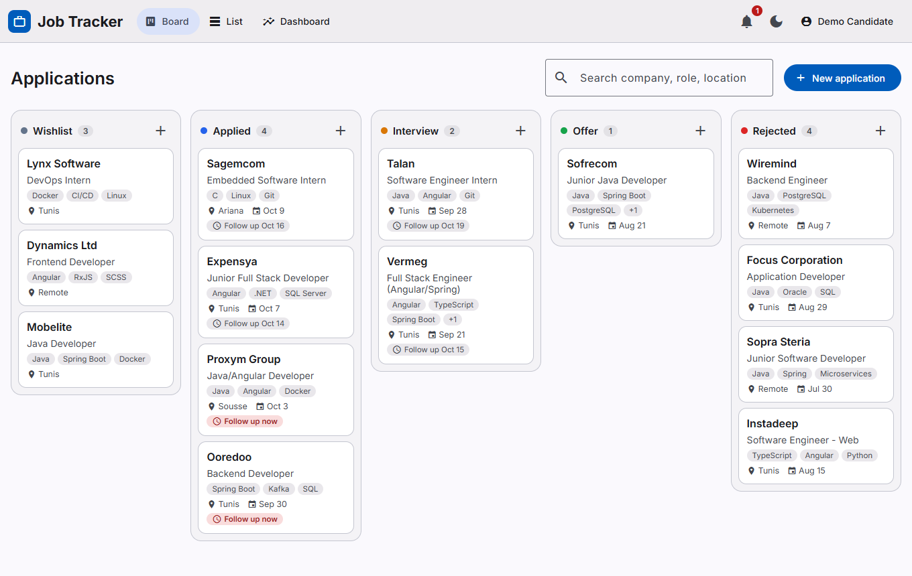
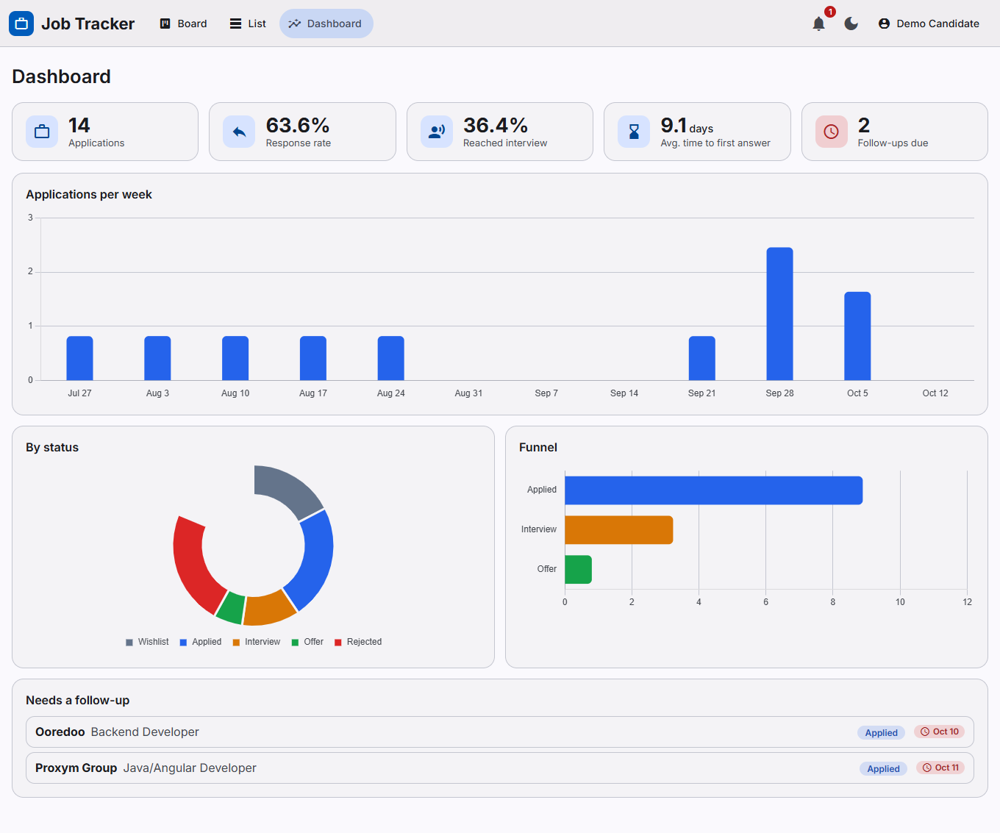
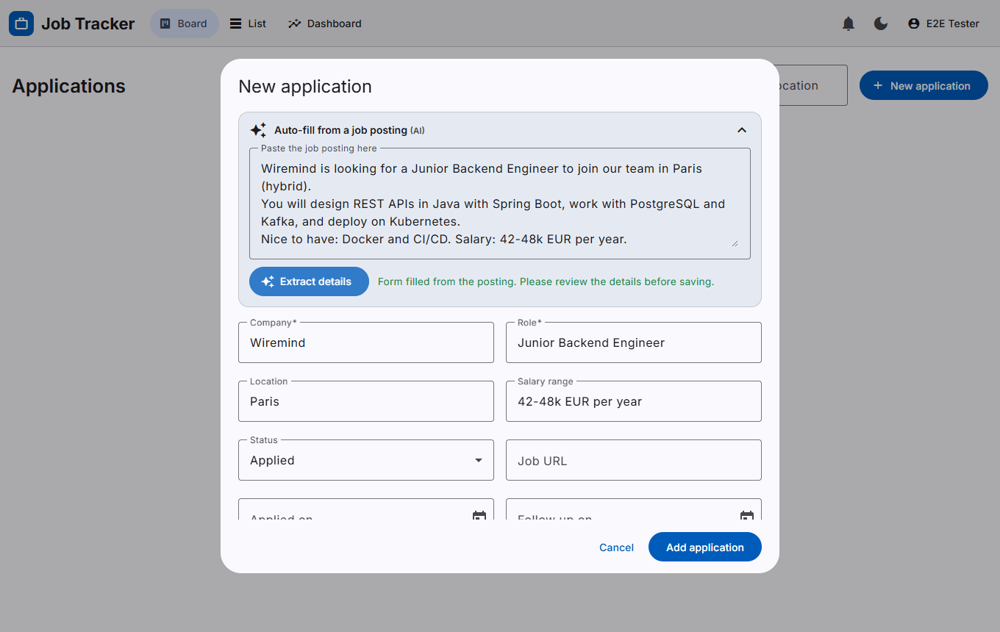
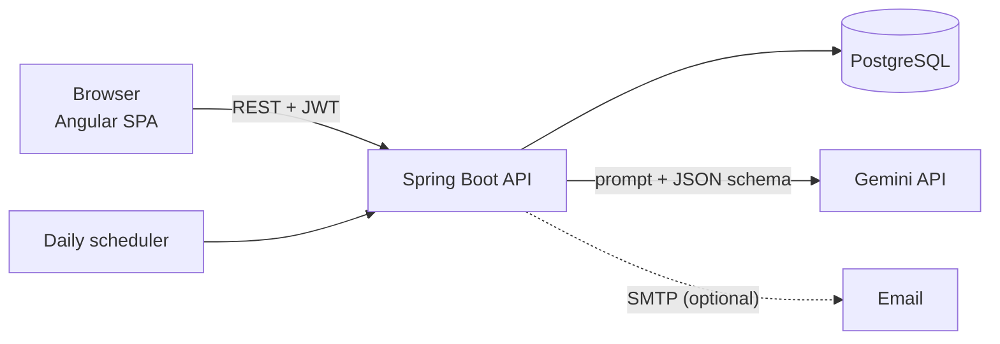

# Job Tracker

A full-stack web app to manage a job search: keep every application on a Kanban board, see analytics about your
funnel, get follow-up reminders, and let AI fill in forms and prepare you for interviews.

> **Live demo:** _add the Vercel URL here after deploying_ &nbsp;|&nbsp; **API docs:** _add the Render URL_`/swagger-ui.html`
> &nbsp;|&nbsp; **Demo login:** `demo@example.com` / `Demo@1234`
> (free hosting: the very first request after a quiet period can take up to a minute while the server wakes up)



| Analytics dashboard | AI auto-fill from a job posting |
|---|---|
|  |  |

## Features

- **Kanban board** with drag and drop: Wishlist, Applied, Interview, Offer, Rejected. Search, list view with server-side filters.
- **Analytics**: response rate, interview rate, average time to the first answer, applications per week, funnel, status breakdown.
- **Follow-up reminders**: a daily scheduled job creates an in-app notification (and an email when SMTP is configured) for
  every application still waiting for a reply whose follow-up date has arrived. Each follow-up date reminds once.
- **AI assistant** (Google Gemini, free tier)
  - paste a job posting and the form fills itself (company, role, location, salary, skills);
  - generate tailored interview questions with answer tips for any application.
- **Accounts**: register / sign in with JWT, every user only sees their own data. A seeded demo account is included.
- Light and dark theme, responsive layout (works on a phone), accessible labels and keyboard navigation.

## Tech stack

| Layer | Technology |
|---|---|
| Frontend | Angular 21 (standalone components, signals), Angular Material 3, CDK drag and drop, Chart.js |
| Backend | Java 17, Spring Boot 3.5, Spring Security (JWT), Spring Data JPA, Bean Validation, Spring Scheduling |
| Database | PostgreSQL 16, Flyway migrations |
| AI | Google Gemini API behind a small `LlmClient` interface, structured JSON output |
| Testing | JUnit 5, Mockito, Testcontainers, Vitest, Playwright |
| DevOps | Docker, Docker Compose, nginx, GitHub Actions, Render + Vercel + Neon (all free tiers) |

## Architecture



Backend packages: `auth`, `security`, `application` (CRUD + status history), `analytics`, `notification`
(reminders, scheduler, mail), `ai`, `config`, `common`. Tables: `users`, `job_applications`, `status_history`, `notifications`.

### Design decisions worth a look

- **Ownership is enforced in the query layer** (`findByIdAndUserId`). Someone else's application answers `404`, exactly like a missing one,
  so ids cannot be probed. Integration tests cover every endpoint for cross-user access.
- **Analytics come from a status history table**, not from guessing. That is what makes "average days to first answer" and
  the funnel accurate. The computation is a pure function (`AnalyticsCalculator`) with its own unit tests.
- **Reminders are idempotent**: `reminder_sent_at` is stored per application and reset only when the follow-up date changes.
- **AI is treated as an untrusted component**: the model call sits behind an interface; the posting is passed as delimited
  data with a system instruction not to follow instructions inside it; the response is schema-constrained, then trimmed,
  de-duplicated and length-limited server-side; there is a per-user rate limit (the free quota is shared), a fallback model,
  and a graceful failure path (the form always works by hand). No database connection is held while waiting for the model.
- **One frontend build for every environment**: the API address is read at runtime from `config.json`
  (written from the `API_URL` variable at build time), so the same code runs on localhost, in Docker and on Vercel.
- **Optimistic UI**: dragging a card moves it instantly and rolls back if the server refuses (unit tested).

## Run it locally

### Option A: Docker (everything in containers)

```bash
cp .env.example .env        # then set JWT_SECRET (and GEMINI_API_KEY if you want AI)
docker compose up --build
```

Open <http://localhost:3000> and sign in with the demo account. The API docs are at <http://localhost:8082/swagger-ui.html>.

### Option B: Development mode

Requirements: JDK 17, Maven, Node 22+, a local PostgreSQL with an empty database called `jobtracker`.

```bash
cp .env.example .env        # set DB_PASSWORD, JWT_SECRET, GEMINI_API_KEY
cd backend && mvn spring-boot:run        # http://localhost:8080
cd frontend && npm install && npm start  # http://localhost:4200
```

On Windows, `.\run-local.ps1` starts both and `.\run-local.ps1 -Stop` stops them.

### Configuration

| Variable | Purpose | Default |
|---|---|---|
| `DB_URL`, `DB_USERNAME`, `DB_PASSWORD` | PostgreSQL connection (JDBC URL) | local `jobtracker` database |
| `JWT_SECRET` | Signing key, at least 32 characters (the app refuses to start without it) | none |
| `GEMINI_API_KEY` | Enables the AI features. Empty = AI endpoints answer 503 and the UI falls back to manual entry | empty |
| `GEMINI_MODEL`, `GEMINI_FALLBACK_MODEL` | Primary and fallback model | `gemini-3.5-flash-lite`, `gemini-3.1-flash-lite` |
| `CORS_ALLOWED_ORIGINS` | Comma-separated list of frontend origins | `http://localhost:4200` |
| `MAIL_HOST`, `MAIL_PORT`, `MAIL_USERNAME`, `MAIL_PASSWORD`, `MAIL_FROM` | SMTP for reminder emails. Without `MAIL_HOST` emails are only logged | empty |
| `REMINDERS_CRON`, `REMINDERS_ZONE` | When the reminder job runs | `0 0 8 * * *`, `UTC` |
| `SEED_DEMO_DATA` | Create the demo account with sample data on startup | `true` |
| `API_URL` _(frontend build)_ | Backend address baked into `config.json`; empty means same origin | unset (keeps `localhost:8080`) |

## Tests

```bash
cd backend  && mvn test                    # 45 tests: unit + integration against a real PostgreSQL (Testcontainers, needs Docker)
cd frontend && npx ng test --watch=false   # 21 unit tests (Vitest)
cd e2e && npm install && npx playwright test   # 24 browser tests against the running app (needs the app on :4200/:8080)
```

The end-to-end suite drives the real UI (login, drag and drop, dialogs, charts, dark mode, mobile layout) against the real API.
Two optional groups are switched on with environment variables: `LIVE_AI=1` calls the real Gemini API, and
`FAST_REMINDERS=1` (start the backend with `REMINDERS_CRON="*/5 * * * * *"`) proves the whole reminder chain.
It uses your installed Chrome; set `BROWSER=chromium` to use Playwright's own browser instead.

## API overview

Interactive documentation is served at `/swagger-ui.html`.

| Method and path | Description |
|---|---|
| `POST /api/auth/register`, `POST /api/auth/login`, `GET /api/auth/me` | Accounts and JWT |
| `GET/POST /api/applications`, `GET/PUT/DELETE /api/applications/{id}` | Applications (`?status=` and `?q=` filters) |
| `PATCH /api/applications/{id}/status`, `GET /api/applications/{id}/history` | Move between stages, view the timeline |
| `GET /api/analytics` | Dashboard numbers |
| `GET /api/notifications`, `POST /api/notifications/{id}/read`, `POST /api/notifications/read-all` | Reminders |
| `POST /api/ai/parse-job`, `POST /api/ai/applications/{id}/interview-prep` | AI features |
| `GET /actuator/health` | Health check |

## Deploy (free tiers)

1. **Database, Neon.** Create a project and a database (for example `jobtracker`). Build the JDBC URL from the connection details:
   `jdbc:postgresql://<host>/<database>?sslmode=require`, plus the user and password. Use the direct (non-pooled) host, because
   Flyway runs migrations on startup. One Neon project can hold a separate database per app.
2. **API, Render.** New Blueprint from this repository (`render.yaml`), then fill in the variables marked `sync: false`:
   `DB_URL`, `DB_USERNAME`, `DB_PASSWORD`, `GEMINI_API_KEY`, and `CORS_ALLOWED_ORIGINS` (your Vercel URL). `JWT_SECRET` is generated for you.
3. **Frontend, Vercel.** Import the repository, set the root directory to `frontend`, and add the environment variable
   `API_URL=https://<your-render-service>.onrender.com`. `vercel.json` handles the build output and SPA routing.
4. Put the live links at the top of this README.

Free hosting note: the API sleeps after a quiet period, so the first request can take up to a minute, and the daily reminder
job runs while the instance is awake.

## Project structure

```
backend/    Spring Boot API (Dockerfile, Flyway migrations in src/main/resources/db/migration)
frontend/   Angular app (Dockerfile, nginx.conf, vercel.json)
e2e/        Playwright end-to-end tests
docker-compose.yml   database + API + web UI in containers
render.yaml          Render blueprint for the API
.github/workflows/   CI: backend tests, frontend tests and build, Docker image builds
```
